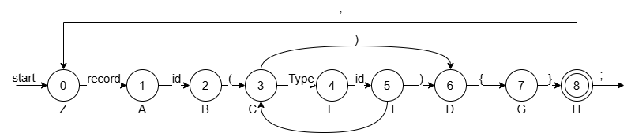
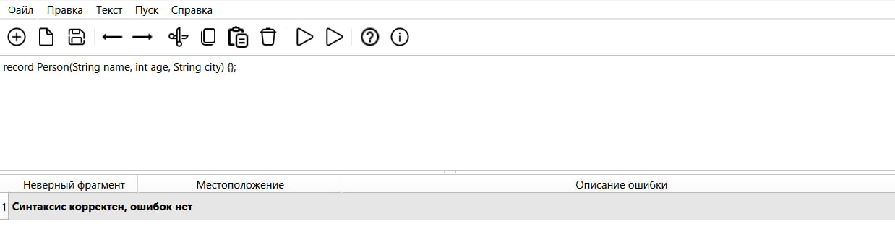
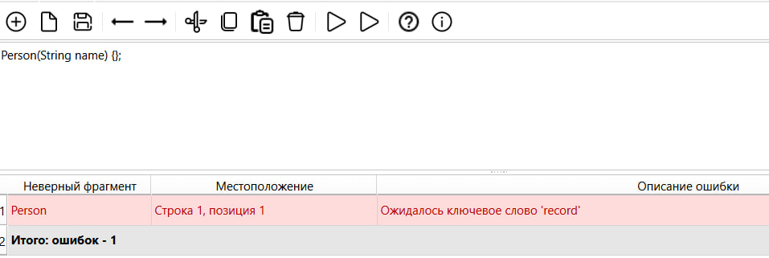
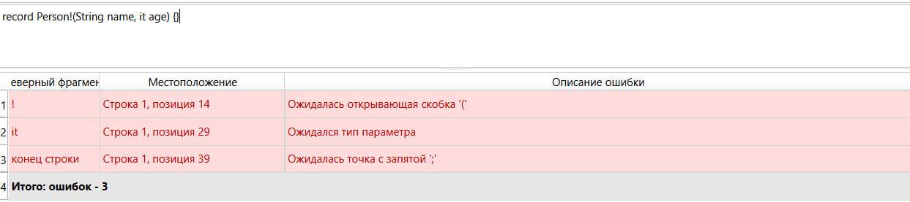
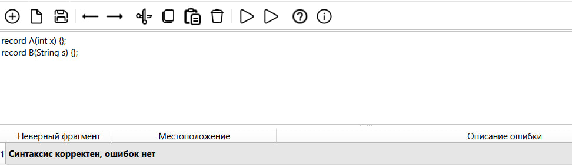
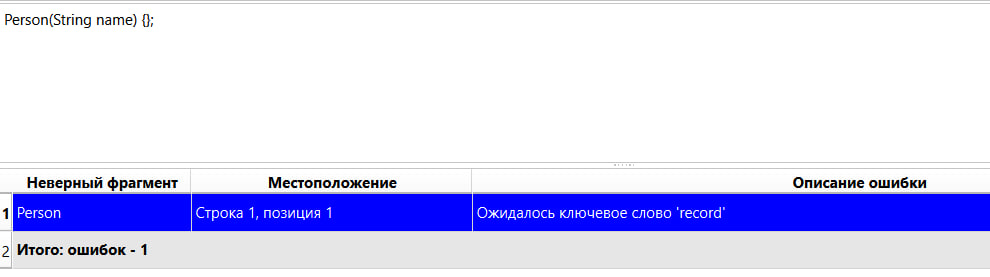
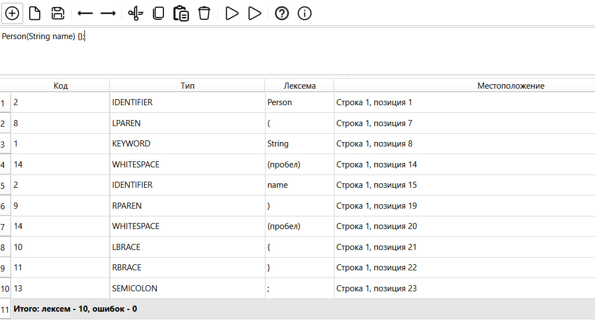

# Лабораторная работа №3 - Разработка синтаксического анализатора (парсера)

## Цель работы

Изучить назначение и принципы работы синтаксического анализатора в структуре компилятора. Разработать автоматную грамматику для заданной синтаксической конструкции, построить соответствующий конечный автомат и выполнить программную реализацию синтаксического анализатора на его основе. Реализовать нейтрализацию синтаксических ошибок методом Айронса и интегрировать разработанный модуль в графический интерфейс языкового процессора.

## Автор

* Башинов Арья Игоревич
* Группа: АП-326

## Постановка задачи

Разработать синтаксический анализатор (парсер) в соответствии с индивидуальным вариантом курсовой работы, интегрировать его в приложение из лабораторной работы №1 и обеспечить наглядный вывод результатов анализа.

### Требования к разработке парсера

* Разработать автоматную грамматику для заданной синтаксической конструкции.
* Построить конечный автомат, соответствующий разработанной грамматике.
* Выполнить программную реализацию алгоритма синтаксического анализа на основе состояний автомата.
* Реализовать алгоритм нейтрализации синтаксических ошибок методом Айронса.
* Интегрировать синтаксический анализатор в существующий графический интерфейс.

### Входные данные

Строка или многострочный текст программного кода из области редактирования.

### Выходные данные

При успешном анализе корректного текста — сообщение об отсутствии синтаксических ошибок.

При обнаружении ошибок — таблица с описанием каждой ошибки, содержащая ошибочный фрагмент, его положение и описание ожидаемой конструкции.

## Вариант задания

**Номер варианта: 17.** Объявление структуры `record` на языке Java.

Пример корректной конструкции:

```java
record Person(String name, int age, String city) {};
```

### Допустимые лексемы

| Лексема                                                                                               | Код |
| ----------------------------------------------------------------------------------------------------- | --- |
| Ключевое слово `record`                                                                               | 1   |
| Ключевые слова типов (`String`, `int`, `long`, `double`, `float`, `boolean`, `char`, `byte`, `short`) | 1   |
| Идентификатор                                                                                         | 2   |
| `(`                                                                                                   | 8   |
| `)`                                                                                                   | 9   |
| `{`                                                                                                   | 10  |
| `}`                                                                                                   | 11  |
| `,`                                                                                                   | 12  |
| `;`                                                                                                   | 13  |

## Разработка автоматной грамматики

Для реализации синтаксического анализа исходная конструкция была представлена в виде праволинейной автоматной грамматики.

Формально грамматика записывается в виде:

```text
G[Z] = (Vn, Vt, P, Z)
```

Множество нетерминальных символов:

```text
Vn = { Z, A, B, C, D, E, F, G, H }
```

Множество терминальных символов:

```text
Vt = {
    record, id,
    String, int, long, double, float,
    boolean, char, byte, short,
    (, ), {, }, ,, ;
}
```

Правила грамматики:

```text
1.  Z -> record A
2.  A -> id B
3.  B -> ( C

4.  C -> ) D
5.  C -> String E
6.  C -> int E
7.  C -> long E
8.  C -> double E
9.  C -> float E
10. C -> boolean E
11. C -> char E
12. C -> byte E
13. C -> short E

14. E -> id F

15. F -> , C
16. F -> ) D

17. D -> { G
18. G -> } H

19. H -> ; Z
20. H -> ε
```

В данной грамматике каждый нетерминал соответствует состоянию конечного автомата, а правило вида `A -> aB` задаёт переход из состояния `A` в состояние `B` по терминальному символу `a`.

Правило `A -> ε` обозначает завершение разбора текущей цепочки.

### Расшифровка обозначений

```text
id      -> буква {буква | цифра | _}
буква   -> 'a'..'z' | 'A'..'Z' | '_'
цифра   -> '0'..'9'
ε       -> пустая цепочка
```

## Классификация грамматики (по Хомскому)

Разработанная грамматика является **автоматной (праволинейной)** и относится к **грамматикам 3 типа** по классификации Хомского.

Правила грамматики представлены в форме:

```text
A -> aB
A -> a
A -> ε
```

где:

* `A`, `B` — нетерминальные символы;
* `a` — терминальный символ;
* `ε` — пустая цепочка.

Такая форма правил позволяет непосредственно представить грамматику в виде конечного автомата, в котором нетерминальные символы используются как состояния, а терминальные символы — как метки переходов.

## Конечный автомат

На основе автоматной грамматики построен конечный автомат для распознавания объявления `record`.

Соответствие нетерминалов грамматики и состояний автомата:

| Нетерминал | Состояние      | Назначение                             |
| ---------- | -------------- | -------------------------------------- |
| `Z`        | `START`        | начало анализа                         |
| `A`        | `RECORD`       | обработка имени `record`               |
| `B`        | `NAME`         | обработка имени записи                 |
| `C`        | `PARAM_START`  | начало списка параметров               |
| `E`        | `PARAM_NAME`   | обработка имени параметра              |
| `F`        | `PARAM_END`    | ожидание `,` или `)`                   |
| `D`        | `LBRACE`       | ожидание `{`                           |
| `G`        | `RBRACE`       | ожидание `}`                           |
| `H`        | `AFTER_RBRACE` | ожидание `;` или следующего объявления |

Работа автомата заключается в последовательном чтении токенов и переходе между состояниями в соответствии с текущей лексемой.

Для корректной конструкции

```text
record Person(String name, int age) {};
```

последовательность основных состояний имеет вид:

```text
START
  ↓ record
RECORD
  ↓ id
NAME
  ↓ (
PARAM_START
  ↓ тип
PARAM_NAME
  ↓ id
PARAM_END
  ↓ , / )
...
```

После обработки `}` автомат переходит в состояние `AFTER_RBRACE`. При наличии `;` выполняется переход к `START`, что позволяет анализировать несколько объявлений последовательно.



## Метод анализа

Синтаксический анализ выполняется методом конечного автомата.

В отличие от рекурсивного спуска, анализатор не использует отдельные рекурсивные процедуры для нетерминалов грамматики. Вместо этого программа хранит текущее состояние автомата и последовательно обрабатывает входные токены.

Основной алгоритм работы парсера:

1. Получить список токенов от лексического анализатора.
2. Удалить токены пробельных символов.
3. Установить начальное состояние `START`.
4. Получить текущий токен.
5. В зависимости от текущего состояния проверить допустимость токена.
6. При корректном токене выполнить переход в следующее состояние.
7. При обнаружении ошибки зафиксировать её и выполнить восстановление.
8. Продолжить анализ с подходящего состояния.
9. После завершения одного объявления перейти к `START` и продолжить анализ следующего.
10. Завершить работу при достижении конца входной последовательности.

В программной реализации используются состояния:

```text
START
RECORD
NAME
PARAM_START
PARAM_NAME
PARAM_END
LBRACE
RBRACE
AFTER_RBRACE
```

Таким образом, программная реализация непосредственно соответствует построенному конечному автомату.

## Диагностика и нейтрализация синтаксических ошибок

Для диагностики и нейтрализации синтаксических ошибок реализован механизм восстановления разбора, основанный на методе Айронса.

При обнаружении несоответствия текущего токена ожидаемой конструкции парсер:

* фиксирует ошибочный фрагмент;
* сохраняет строку и позицию ошибки;
* формирует описание ожидаемого токена;
* выполняет локальное восстановление;
* продолжает работу автомата с подходящего состояния.

Восстановление выполняется таким образом, чтобы анализатор мог продолжить обработку последующих токенов и обнаружить несколько независимых синтаксических ошибок в одном исходном тексте.

В качестве точек восстановления используются структурные элементы объявления:

* `record` — начало нового объявления;
* `;` — конец объявления;
* `(` и `)` — границы списка параметров;
* `{` и `}` — границы тела записи;
* `,` — разделитель параметров.

Такой подход позволяет не прекращать анализ после первой ошибки.

Например, для входных данных:

```java
record Person!(String name, it age) {}
```

анализатор обнаруживает несколько ошибок:

| Фрагмент     | Положение            | Описание                         |
| ------------ | -------------------- | -------------------------------- |
| `!`          | строка 1, позиция 14 | Ожидалась открывающая скобка `(` |
| `it`         | строка 1, позиция 29 | Ожидался тип параметра           |
| конец строки | строка 1, позиция 39 | Ожидалась точка с запятой `;`    |

Таким образом, одна строка может содержать несколько диагностируемых синтаксических ошибок, а анализатор продолжает работу после их обнаружения.

## Интерфейс программы

Функциональность интерфейса:

* ввод текста в область редактирования;
* запуск лексического анализа по F5 или через меню «Пуск -> Лексический анализ»;
* запуск синтаксического анализа по F6 или через меню «Пуск -> Синтаксический анализ»;
* вывод найденных ошибок в таблицу;
* отображение общего количества найденных ошибок;
* отображение положения каждой ошибки;
* переход к месту ошибки по щелчку на строке таблицы;
* подсветка ошибочных строк красным цветом.

## Тестовые примеры

### Пример корректного ввода

Входная строка:

```java
record Person(String name, int age, String city) {};
```

Результат работы программы:



### Пример некорректного ввода

Входная строка:

```java
record Person(name, int age) {};
```

В первом параметре отсутствует тип.

Результат работы программы:



### Пример нескольких синтаксических ошибок

Входная строка:

```java
record Person!(String name, it age) {}
```

В данной строке допущено несколько синтаксических ошибок. Парсер обнаруживает их последовательно и выводит в таблицу диагностики.



### Пример многострочного ввода

Входная строка:

```java
record A(int x) {};
record B(String s) {};
record C(double d) {};
```

Результат работы программы:



### Навигация по ошибкам

При щелчке на строке таблицы с ошибкой курсор в области редактирования устанавливается на позицию соответствующего ошибочного фрагмента.



### Лексический анализ

Для сравнения приведён результат лексического анализа той же строки по F5.



## Используемые технологии

* Язык программирования: Python 3.10+
* GUI-фреймворк: PySide6 (Qt for Python)
* Среда разработки: Visual Studio Code

## Инструкция по сборке и запуску

Клонировать репозиторий:

```powershell
git clone https://github.com/korposs/TFYAK_Lab3.git
cd TFYAK_Lab3
```

Установить зависимости:

```powershell
py -m pip install -r requirements.txt
```

Запустить приложение:

```powershell
py main.py
```

В средах, где Python запускается командой `python`, использовать её вместо `py`.

## Структура проекта

```text
TFYAK_Lab3/
├── main.py                       # точка входа приложения
├── text_editor.py                # главное окно и логика интерфейса
├── requirements.txt
├── README.md
├── .gitignore
├── compiler/
│   ├── __init__.py
│   ├── grammar.py                # константы грамматики
│   ├── scanner.py                # лексический анализатор (ЛР2)
│   └── parser.py                 # автоматный синтаксический анализатор (ЛР3)
├── resources/
│   └── icons/                    # иконки панели инструментов
└── images/                       # иллюстрации для README
```

## Ограничения

* Семантический анализ не реализован. Пункт «Семантический анализ» появится в лабораторной работе №5.
* Пункты меню «Текст» открывают окна с краткими описаниями-заглушками.
* Поддерживается работа с одним документом в одном окне.
* Подсветка синтаксиса отсутствует.
* Файлы читаются и сохраняются только в кодировке UTF-8.
* Парсер проверяет только синтаксическую структуру объявления `record`, заданную вариантом работы.

## Вывод

В ходе лабораторной работы был разработан синтаксический анализатор на основе конечного автомата, который:

* использует автоматную праволинейную грамматику 3 типа по классификации Хомского;
* выполняет последовательный анализ токенов с использованием состояний автомата;
* проверяет структуру объявлений `record` на языке Java;
* распознаёт последовательность объявлений в многострочном тексте;
* корректно обрабатывает пустой список параметров;
* обнаруживает несколько синтаксических ошибок за один запуск;
* выполняет нейтрализацию синтаксических ошибок методом Айронса;
* продолжает анализ после обнаружения ошибки;
* определяет строку и позицию каждого ошибочного фрагмента;
* интегрирован в графический интерфейс, разработанный в лабораторной работе №1.
